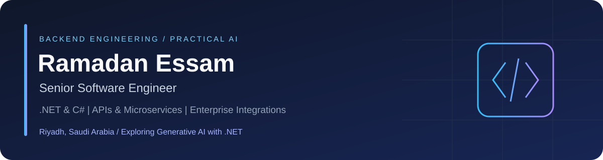

<p align="center">
  
</p>

# Ramadan Essam

**Senior Software Engineer | .NET & C# | Backend Systems, APIs & Enterprise Integrations**

Riyadh, Saudi Arabia · [LinkedIn](https://www.linkedin.com/in/ramadanessameita/) · [AI Learning Lab](https://github.com/RamadanEssam/dotnet-generative-ai-learning)

I build and modernize enterprise applications, connect systems through secure APIs, and help teams take ownership of complex backend platforms. My professional experience spans government and business applications, legacy modernization, SSO, API gateways, and delivery coordination.

I am extending that backend foundation through hands-on **Generative AI learning with .NET and local Ollama**. My AI repositories are educational prototypes, separate from my professional production experience.

## Engineering dashboard

### 01 / Backend & architecture

**C# · .NET · ASP.NET Core · REST APIs · Entity Framework Core**

Clean Architecture, microservices, SOLID principles, and maintainable application boundaries. Experience supporting both modern services and legacy .NET applications.

### 02 / Integration & identity

**Apigee · Ocelot · SSO · Zoho · Elsa Workflows**

API integration between enterprise systems, gateway routing, centralized authentication, and business workflow integration.

### 03 / Data, delivery & troubleshooting

**SQL Server · Oracle · Redis · Azure DevOps · IIS**

Centralized logging with Serilog, Elasticsearch, and Kibana; technical handovers, deployment coordination, and disaster-recovery readiness.

### 04 / Full-stack collaboration

**Angular · React · Vue.js · TypeScript**

Experience delivering frontend modules and integrating them with backend APIs. Backend engineering remains my primary focus.

## Selected professional experience

The following summarizes my supplied CV. Client source code and internal implementation details are not published here.

- **Senior Software Engineer (contract), Ministry of Justice — Aug 2025 to present.** .NET backend development, government-system API integrations through Apigee, Oracle-backed applications, centralized logging, and delivery coordination through Azure DevOps and IIS.
- **Senior Backend Developer (contract), National Development Fund — May 2024 to Aug 2025.** Technical handover, Clean Architecture application development, SSO, API integration, and workflow integration.
- **Software Engineer II, Softec Technologies — May 2023 to Apr 2024.** Fleet-management development and modernization using ASP.NET Core, EF Core, and Angular, alongside legacy application support.
- **Earlier experience:** .NET and frontend development at Procoor and WesamSoft; professional full-stack training at ITI.

## Featured repositories

### [.NET Generative AI Learning](https://github.com/RamadanEssam/dotnet-generative-ai-learning)

**Problem:** understand how to integrate language models into a .NET backend without coupling all application logic to a model SDK.

**Work in this repository:** implemented and adapted course examples for local Ollama, plus a stock-lookup exercise, with Arabic learning notes and execution diagnostics.

**Stack:** .NET 10, Microsoft.Extensions.AI, OllamaSharp, VectorData, in-memory vector storage.

**Evidence:** streaming chat, structured extraction, automatic C# tool execution, local embeddings, and movie retrieval with Top-K and an example threshold. Educational data; no production AI deployment, Qdrant, or RAG is claimed.

### [Ocelot API Gateway Example](https://github.com/RamadanEssam/OcelotGatewayExample)

**Problem:** expose product and user APIs through a common entry point.

**Implementation:** Ocelot routing configuration, separate CRUD APIs, service interfaces, EF Core, and SQL Server migrations.

**Stack/status:** ASP.NET Core 7, Ocelot 19.0.2; a legacy practice sample. Build verified during portfolio review; database and HTTP flows were not executed. Broad CORS and missing production policies are documented limitations.

### [JWT & Refresh Token API](https://github.com/RamadanEssam/JWTRefreshTokenSaqaya)

**Problem:** explore access-token issuance and refresh-token lifecycle in an ASP.NET Core API.

**Implementation:** registration/sign-in, Identity-backed users, refresh-token rotation/revocation, and a protected endpoint.

**Stack/status:** .NET 6, ASP.NET Core Identity, EF Core, SQL Server. Historical learning sample; build verified with warnings. It needs dependency and authorization hardening before deployment and is not a production security reference.

### [Shaghalny Job Portal](https://github.com/RamadanEssam/Shaghalny-Website)

**Problem:** connect job listings with applicant workflows.

**Implementation visible in the repository:** job/category management, applications, CV upload/download paths, search, and saved jobs.

**Stack/status:** ASP.NET MVC on .NET Framework 4.7.2, EF6, Identity/OWIN, SQL Server. Historical educational project; code reviewed, runtime not verified. No authorship percentage, hosted demo, or hiring outcome is claimed.

Other repositories include earlier exercises and forks used for study. A fork is not presented as an original project or proof of contribution to its upstream codebase.

## Current learning focus

**Practiced:** IChatClient, streaming, chat history, classification, structured extraction, automatic function invocation, embeddings, cosine similarity, and in-memory vector indexing/retrieval.

**Next:** persistent vector stores, RAG, and evaluation of retrieval and generated responses. These are learning goals, not completed production capabilities.

```text
User intent → model chooses a tool → .NET executes an allowed function
→ trusted application data → tool result → assistant response
```

The backend remains responsible for authorization, validation, business rules, and access to data. Model output still needs verification.

## How I work

**Understand → Build → Inspect → Test → Document**

I value clear contracts, readable code, and evidence from actual execution. There are no self-assigned skill percentages or activity-based expertise scores here.

For professional conversations about .NET backend engineering, enterprise integrations, or practical AI integration, [connect on LinkedIn](https://www.linkedin.com/in/ramadanessameita/).
